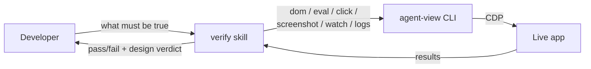

# Workflow

The plugin adds the `verify` skill: it launches the app, picks the cheapest tool that can answer each question (`eval` before `dom` before `screenshot`), executes the checks against the live app, and reports pass / fail / requires-visual-review per step.



## Ad-hoc

```text
Verify: after clicking Save, the button must be disabled until network completes. No console errors.
```

## From a plan or a diff

```text
Verify the scenarios in .claude/plans/2026-04-27-login-redirect.md for commits <hash1>..<hash2>.
Symptom: after login, redirect went to /home instead of /dashboard.

Design references (optional):
- /abs/path/figma-exports/post-login.png   → "post-login dashboard"
```

When something fails:

```text
Step 4 failed (zone filter not mutating store). Fix and re-run that step plus step 7.
```

## Anti-patterns

- "Just verify the feature" with no symptom. Without knowing what "works" means, the skill can't pick the cheapest signal.
- Pasting Figma URLs. agent-view doesn't fetch from Figma; export to PNG and pass the local path.
- 50 assertions in one run. Split per-feature; a verification pass should finish in under 2 minutes.

## Other agents

The CLI is the whole product. Any agent that can run shell commands can use it:

```bash
agent-view discover                  # JSON: window IDs, titles, URLs
agent-view dom --filter "Submit"     # AX tree, with refs
agent-view fill 3 "hello@example.com"
agent-view click 7
agent-view eval "store.state.user.role"
agent-view screenshot --crop "Sidebar" --scale 0.5
```

For agents that benefit from a system-prompt shim, copy the gist of [`skills/verify/SKILL.md`](skills/verify/SKILL.md) into your agent's instructions. The DOM-first workflow and tool-selection table are framework-agnostic.
